

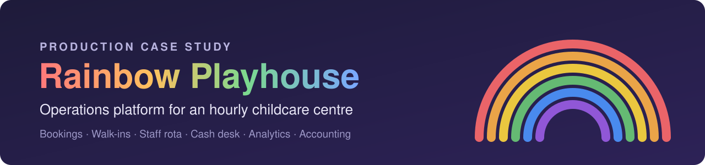

 

**[Overview](#overview) · [Product tour](#product-tour) · [Architecture](#architecture) · [Engineering highlights](#engineering-highlights) · [Documentation](#documentation)**

 

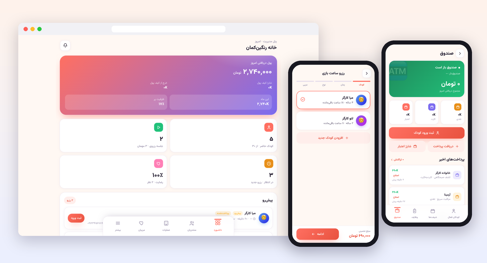

 

## Overview

**Rainbow Playhouse** is a children's play and hourly-care centre in Tehran. On a normal day the centre handles pre-booked sessions and a steady stream of walk-ins. A coach is rostered to every child, a staffed cash desk takes payments, and the owner closes out the till at the end of the day.

I designed, built, deployed and operate the platform that runs it. One Persian-language, right-to-left web app replaced paper rotas, a manual till and spreadsheet reporting. It serves **four role-specific portals** (parent, coach, supervisor and owner) from a single REST API. **The server owns every rule** that involves money, time or access.

The platform has been **live since August 2026**. It handles real bookings, walk-in check-ins, payments and payroll every day.

<table>
<tr>
<td align="center" width="25%"><h3>4</h3>role-based portals</td>
<td align="center" width="25%"><h3>110+</h3>REST endpoints</td>
<td align="center" width="25%"><h3>22</h3>data models</td>
<td align="center" width="25%"><h3>101</h3>end-to-end API tests</td>
</tr>
<tr>
<td align="center"><h3>~16.6k</h3>lines of application code</td>
<td align="center"><h3>14 → 0</h3>dependency CVEs</td>
<td align="center"><h3>7–8 ms</h3>dashboard &amp; analytics queries</td>
<td align="center"><h3>fa-IR</h3>RTL · Jalali · Tehran clock</td>
</tr>
</table>

> [!NOTE]
> This repository is a **documentation and design showcase**. The source code is private because it runs a live business. All screenshots come from a local instance seeded with **fictional demo data**, so no customer information appears here. Code walkthroughs are available on request.

 

## Product Tour

### Owner: run the business
| Dashboard | Analytics | Accounting | Day archive |
|:---:|:---:|:---:|:---:|
| 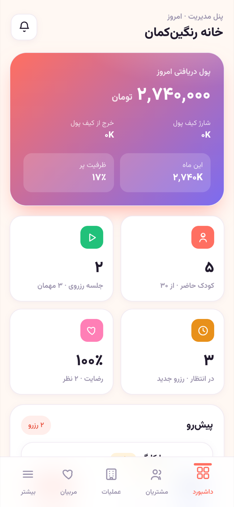 | 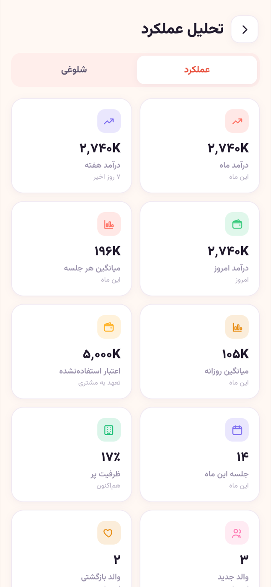 | 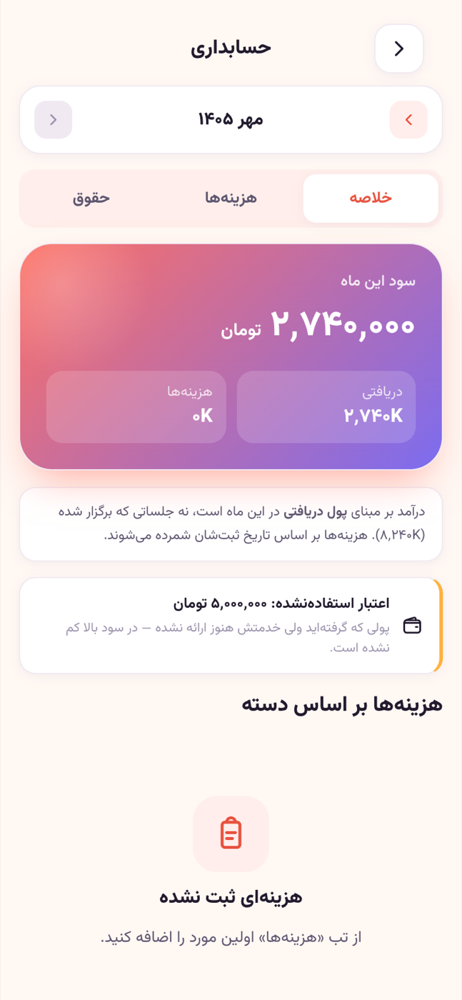 | 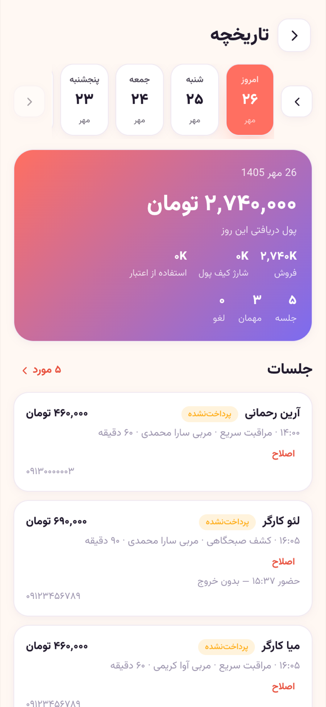 |
| Today's takings, room occupancy, upcoming sessions | Busy hours and weekdays, revenue trend, repeat rate | Expenses, payroll runs, monthly profit &amp; loss | Any past day in full, on the Jalali calendar |

| Team &amp; coaches | Centre settings |
|:---:|:---:|
| 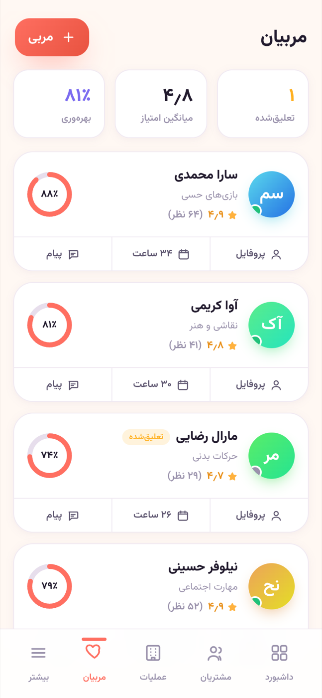 | 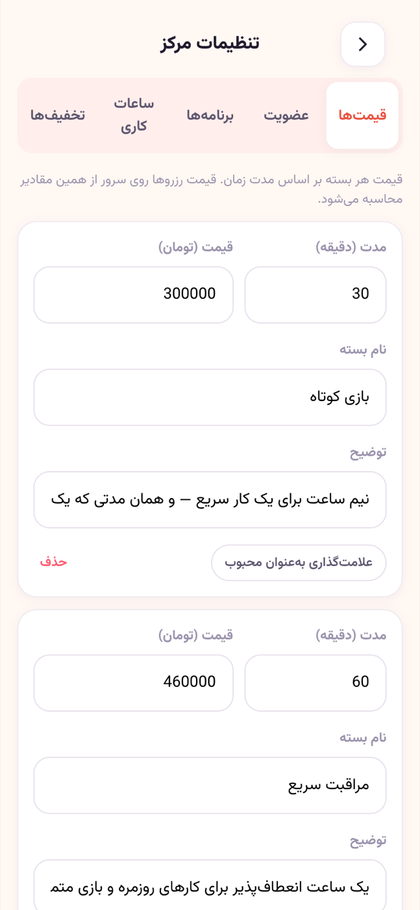 |
| Ratings, utilisation, access levels | Prices, tiers, discounts and opening hours, with no code changes |

### Parents: book and stay informed
| Booking flow | Check-in QR | My bookings | Daily reports | Wallet |
|:---:|:---:|:---:|:---:|:---:|
| 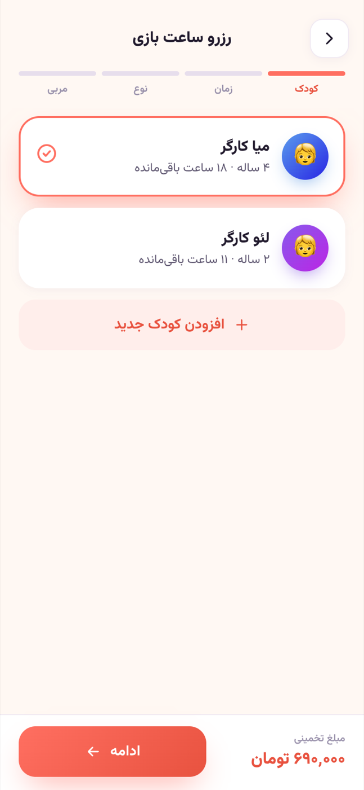 | 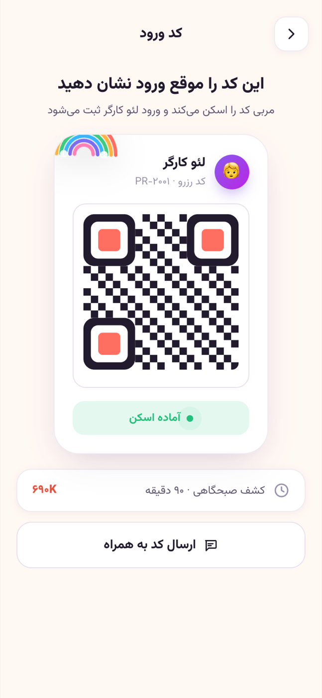 | 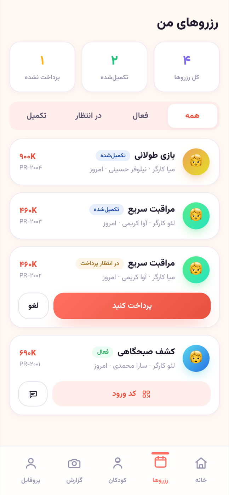 | 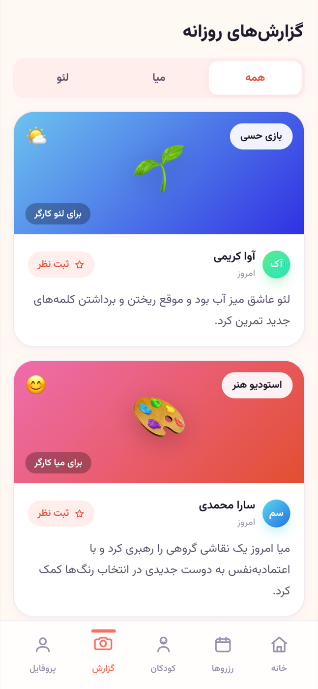 | 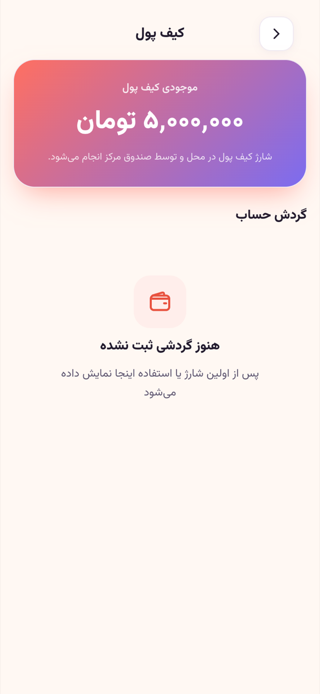 |

### Staff: run the floor
| Coach: today | Coach: shift rota | Supervisor: children present | Supervisor: cash desk |
|:---:|:---:|:---:|:---:|
| 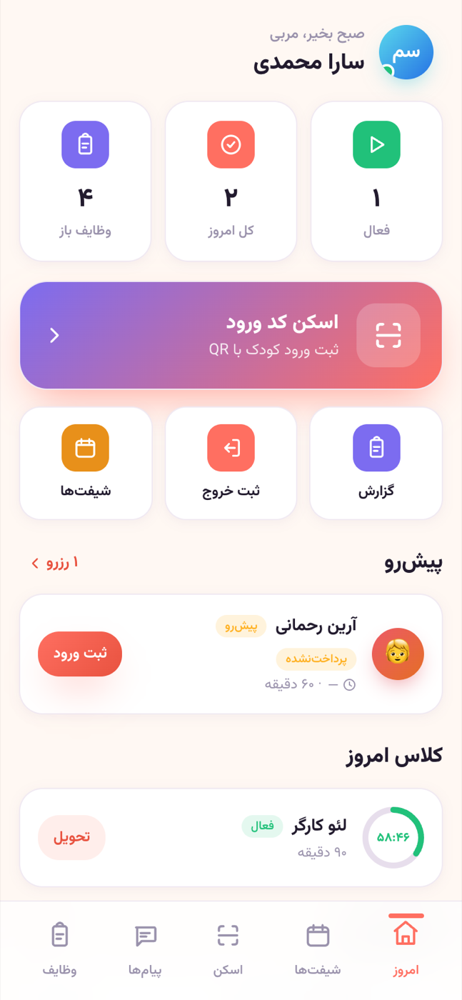 | 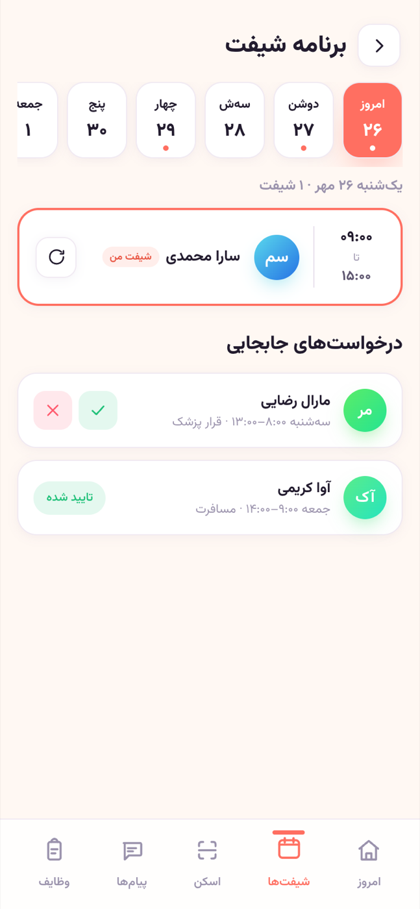 | 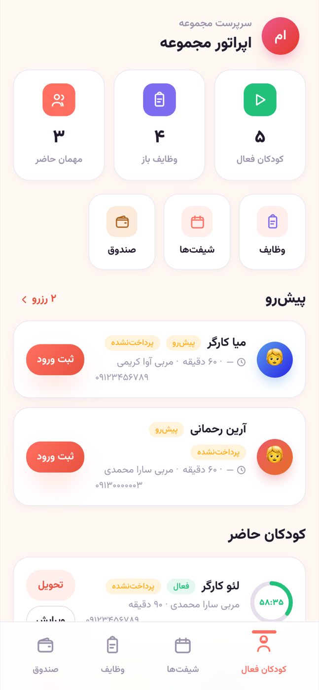 | 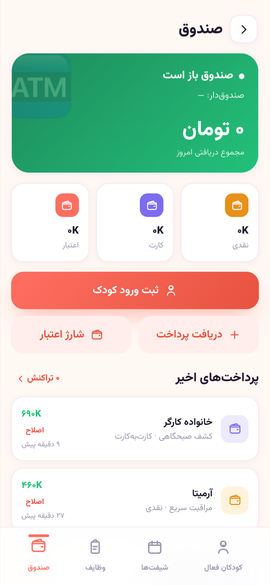 |

 

## Architecture

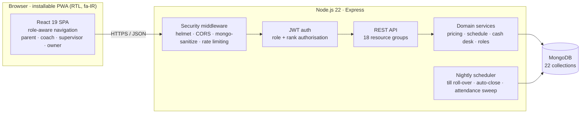

**Design principle: one question, one module.** Every business rule lives in exactly one server module, and every route imports it. Examples are what a session costs, whether a coach is bookable at 17:30, and who may open the till right now. Because no route has its own copy of a rule, two screens can't drift apart. The client is a thin, role-aware presentation layer.

→ [System architecture](docs/02-architecture.md) · [Domain model](docs/03-domain-model.md)

 

## Engineering Highlights

<table>
<tr>
<td width="50%" valign="top">

**💰 Server-authoritative pricing** 
Packages, loyalty tiers, first-booking and off-peak discounts are all configured by the owner and computed only on the server. Discounts stack with a cap, and prices sent by the client are ignored.

</td>
<td width="50%" valign="top">

**🗓️ Rota-driven access** 
A coach can be booked only while rostered. Cash-desk access comes from a shift marked as the till shift and expires on its own when that shift ends.

</td>
</tr>
<tr>
<td valign="top">

**📊 One money model** 
The dashboard, analytics, day archive, till and P&amp;L all read one cash-basis function. Before that, five screens each computed revenue their own way and disagreed with each other.

</td>
<td valign="top">

**🌙 Self-running end of day** 
An in-process scheduler seals the till at closing time, opens the next day's register with the carried float, and closes stale attendance. It never takes money on its own.

</td>
</tr>
<tr>
<td valign="top">

**🕰️ Tehran time, Jalali calendar** 
The server and client share one clock module. It handles Jalali month arithmetic, past-slot blocking and Persian-digit normalisation, so the Tehran date stays correct whatever the server's UTC clock or the device's timezone says.

</td>
<td valign="top">

**🔐 Security-audited** 
A black-box audit against a running server covered the authorisation matrix, IDOR, privilege escalation and NoSQL injection. Fixes included hardened headers, account-keyed rate limiting, and taking dependency CVEs from 14 to 0.

</td>
</tr>
</table>

Each of these came out of a real production problem. The [engineering case studies](docs/06-engineering-case-studies.md) walk through **symptom → root cause → fix → result** for eight of them, for example:

- **Persian digits made a rostered coach unbookable**: a single normalisation boundary fixed it everywhere.
- **Walk-ins were invisible to the owner's reports**: bookings and guests were folded into one revenue series.
- **A staff action was filed under the wrong family**: ownership is now derived from the child, never from the logged-in user.
- **Analytics were unbounded**: windowed loads, shared pre-loading and compound indexes brought every request down to single-digit milliseconds.

 

## Documentation

| | Document | What's inside |
|:---:|---|---|
| 1 | [Product Overview](docs/01-product-overview.md) | Business context, the four roles, core user journeys |
| 2 | [System Architecture](docs/02-architecture.md) | Runtime topology, module map, request lifecycle, frontend structure |
| 3 | [Domain Model](docs/03-domain-model.md) | Entity-relationship diagram and the invariants each model protects |
| 4 | [Key Features](docs/04-key-features.md) | Pricing, check-in, cash desk, end of day, analytics, accounting |
| 5 | [Security](docs/05-security.md) | Threat model, controls, audit methodology and findings |
| 6 | [Engineering Case Studies](docs/06-engineering-case-studies.md) | Eight production problems: root cause, fix, result |
| 7 | [Quality &amp; Testing](docs/07-quality-and-testing.md) | Test strategy, performance work, migration discipline |
| 8 | [Deployment &amp; Operations](docs/08-deployment-and-ops.md) | CI/CD pipeline, environments, observability, backups |
| 9 | [Roadmap](docs/09-roadmap.md) | Planned and in-progress work |

 

## Technology

| Layer | Stack |
|---|---|
| **Frontend** | React 19, Vite 7, custom component library (sheets, segmented controls, charts), Lucide icons, installable PWA |
| **Backend** | Node.js 22, Express, express-validator, helmet, express-rate-limit, express-mongo-sanitize |
| **Data** | MongoDB with Mongoose 8, indexed aggregates for analytics |
| **Auth** | JWT access and refresh tokens, bcrypt, role- and rank-based authorisation |
| **Quality** | Node.js test runner over HTTP (101 tests), Babel AST client-scope check, load benchmark |
| **Delivery** | GitHub Actions: build, deploy, environment, logs, backup and migration workflows |
| **Hosting** | Managed PaaS (Iran region), custom domain behind a CDN with managed TLS |

 

## About

**Sepehr Kiaei**: product design, full-stack development, deployment and operations.

I built this end to end for a real business, from the first requirements conversation with the owner to running it in production. If you'd like a code walkthrough or a live demo, feel free to get in touch through my GitHub profile.

© 2026 Sepehr Kiaei. All rights reserved. See [LICENSE](LICENSE).
