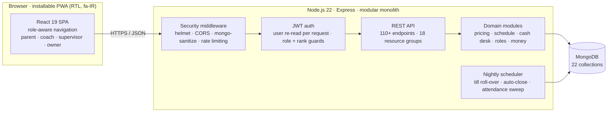

 

**[Summary](#executive-summary) · [Impact](#business-impact) · [Problem](#the-problem) · [Solution](#the-solution) · [Architecture](#architecture) · [Decisions](#key-engineering-decisions) · [Quality](#quality-and-delivery) · [Docs](#documentation)**

 

 

## Executive Summary

**Rainbow Playhouse** is a commercial children's play and hourly-care centre in Tehran. Its revenue depends on selling supervised time, mostly to walk-in families, across a rota of coaches and a staffed cash desk.

I designed, built and operate the platform that runs the business end to end. It is a Persian-language, right-to-left web application with **four role-based portals** (parent, coach, supervisor and owner) on one REST API. It replaced a paper rota, a manual cash box and spreadsheet reporting with a single system of record. **Every rule that touches money, time or access is enforced on the server.**

The platform went live in **August 2026** and runs the centre's daily operations: bookings, walk-in check-ins, payments, staff scheduling, end-of-day close-out, payroll and monthly P&L.

> [!NOTE]
> This repository is a **case study**. The source code is private because it runs a live business. Every screenshot comes from a local instance seeded with **fictional data**, and the usage figures below are aggregate counts only. Code walkthroughs are available on request.

 

## Business Impact

Aggregate production counts from the **first 30 days of operation** (19 Aug – 18 Sep 2026).

<table>
<tr>
<td align="center" width="25%"><h2>~300</h2>child sessions managed</td>
<td align="center" width="25%"><h2>411</h2>payment transactions settled</td>
<td align="center" width="25%"><h2>43</h2>families onboarded</td>
<td align="center" width="25%"><h2>28</h2>trading days on the live till</td>
</tr>
<tr>
<td align="center"><h2>80%</h2>of visits were walk-ins, now fully tracked</td>
<td align="center"><h2>7</h2>coaches scheduled through the rota</td>
<td align="center"><h2>22</h2>staff tasks assigned against shifts</td>
<td align="center"><h2>5.0 / 5</h2>average session rating (16 reviews)</td>
</tr>
</table>

| Area | Before | After |
|---|---|---|
| **Scheduling** | Paper rota, not connected to bookings | Rota-driven booking: a coach can be booked only while rostered |
| **Cash handling** | Manual cash box and end-of-day counting | Audited till with a record of every transaction, automatic nightly close and carried float |
| **Walk-in visibility** | Walk-ins, the large majority of visits, were not tracked | Every walk-in counts in revenue, occupancy, utilisation and customer history |
| **Pricing** | A fixed price list applied by hand | Owner-configured packages, loyalty tiers and stacked discounts, priced on the server |
| **Reporting** | Spreadsheets, rebuilt by hand | Live dashboard, analytics, day-by-day archive and a monthly Jalali P&L, all from one money model |
| **Staff cost** | Calculated outside any system | Pay profiles, monthly payroll runs with approval, and salaries posted to expenses automatically |
| **Access control** | Informal | Least privilege: till access exists only during a rostered till shift |

 

## The Problem

The centre sells **time**, and the way it operates shaped every requirement:

| Operational reality | What the system had to guarantee |
|---|---|
| Most visits are **unplanned walk-ins** | Walk-ins are first-class records and appear in every figure that bookings do |
| **Staffing changes weekly** | The rota is the single source of truth for who can be booked, assigned a task or given the till |
| **Cash, card and prepaid wallet credit** coexist | Each payment is counted exactly once, on a cash basis that matches the physical drawer |
| The **owner is not an accountant** | Every figure states what it measures and over which period |
| The business runs on **Tehran time and the Jalali calendar** | All date logic is correct regardless of the server's UTC clock or the device's settings |
| The system holds **children's data and money** | Strict role- and ownership-based authorisation, verified by a black-box audit |

 

## My Role

**Sole engineer with end-to-end ownership**, from the first requirements conversation with the owner to running the system in production.

- **Product:** gathered requirements from the owner and staff, mapped the operational workflows, and designed the UX for four personas.
- **Engineering:** built the React SPA, the Express/MongoDB API, the domain model (22 collections) and the pricing, scheduling and accounting engines.
- **Security:** threat-modelled the system, then ran and remediated a black-box audit (authorisation matrix, IDOR, privilege escalation, injection).
- **Delivery and operations:** set up CI/CD, environments, backups and migrations, and handle production incidents and data integrity.
- **Iteration:** shipped continuous improvements based on how the centre actually used the system, each with a regression test.

 

## The Solution

### Owner: run the business on reliable numbers
| Live dashboard | Analytics | Accounting &amp; P&amp;L | Day archive |
|:---:|:---:|:---:|:---:|
|  |  |  |  |
| Money received today, occupancy against capacity, upcoming sessions | Demand by hour and weekday for staffing; revenue trend; repeat rate | Expenses, approved payroll runs and a monthly profit-and-loss statement | Any past trading day reconstructed in full |

| Workforce management | Commercial settings |
|:---:|:---:|
|  |  |
| Ratings, utilisation, access levels and suspension | Prices, tiers, discounts, opening hours and capacity, changed with no deploy |

### Parents: self-service booking and transparency
| Guided booking | QR check-in | Bookings | Session reports | Prepaid wallet |
|:---:|:---:|:---:|:---:|:---:|
|  |  |  |  |  |

### Staff: run the floor and the till
| Coach: today's children | Coach: shift rota | Supervisor: children on site | Supervisor: cash desk |
|:---:|:---:|:---:|:---:|
|  |  |  |  |

 

## Architecture

**Guiding principle: one question, one authority.** Every business rule lives in exactly one server module, and every route imports it. Examples are what a session costs, whether a coach is bookable at 17:30, and who may operate the till right now. Two screens therefore can't give two different answers to the same question.

### Non-functional requirements

| Requirement | How it is met |
|---|---|
| **Financial correctness** | One cash-basis money function behind every figure; prices computed only on the server; settlement derived from recorded payments, not status flags |
| **Security and privacy** | Role and rank authorisation plus per-object ownership checks; field-level write whitelists; NoSQL-injection sanitisation; CSP, HSTS and account-keyed rate limiting |
| **Performance** | Windowed queries, shared pre-loading and compound indexes: dashboard **7 ms**, analytics **8 ms** median |
| **Reliability** | Idempotent end-of-day jobs that correct themselves after restarts; rehearsed, idempotent migrations; backups before risky operations |
| **Localisation** | Fully RTL Persian UI, Jalali calendar and Tehran clock shared by client and server, safe Persian-digit normalisation |
| **Operability** | Single deployable unit, CI-built artefacts, workflow-driven logs, backups and migrations with no shell access to production |

→ [System architecture](docs/02-architecture.md) · [Domain model](docs/03-domain-model.md)

 

## Key Engineering Decisions

| Decision | Alternative considered | Why | Trade-off accepted |
|---|---|---|---|
| **Modular monolith**: SPA and API in one process | Separate frontend hosting, microservices | One engineer, one site: one deployable unit, no CORS or cookie complexity | Frontend and API scale together |
| **Server-authoritative pricing** through one quote function | Client-side pricing with validation | The quoted figure always equals the charged figure; tamper-proof | A round trip per quote, mitigated by a 30 s settings cache |
| **Cash-basis money model** | Accrual with prepaid liability | Matches the physical drawer; one number per period everywhere | Unused prepaid credit is reported separately |
| **Till access derived from the rota** | A permanent cashier role or flag | Least privilege that expires on its own | An async database check on money routes |
| **User re-read on every request** | Role claims trusted from the JWT | Suspensions and demotions take effect immediately | One indexed read per request |
| **Shared Tehran/Jalali time module** (client and server) | A date library on each side | Offered slots and accepted slots can never disagree | Defensive handling of ICU differences |
| **In-process scheduler** | External cron | The host has no cron; it self-corrects with no extra infrastructure | Assumes a single instance |
| **Business parameters as data** | Constants in code | The owner changes the commercial model with no deploy | Every new setting must be whitelisted |

→ Full reasoning in the [Architecture Decision Record](docs/10-architecture-decisions.md)

 

## Problems Solved in Production

Each of these came from real usage and is documented as **symptom → root cause → fix → business impact** in the [engineering case studies](docs/06-engineering-case-studies.md):

| Problem | Root cause | Outcome |
|---|---|---|
| Owner reports missed most of the business | Aggregates read bookings only; walk-ins were ~97% of visits in one window | Walk-ins counted everywhere; a coach's record went from **0 to 70 sessions** |
| Five screens reported five different revenue figures | Independent calculations, mixed accrual and cash, double-counted top-ups | One `moneyFor()` model, enforced by a cross-screen regression test |
| A rostered coach could never be booked | Persian digits in stored times were rejected by the time parser | One normalisation boundary repaired 16 call sites and the existing data |
| Past slots were bookable and month labels were four months off | Device clock, UTC midnight and Gregorian months with Persian labels | A shared Tehran/Jalali module; the server rejects past slots |
| Desk bookings were filed under the cashier | Ownership taken from the logged-in user, not the child | Ownership derived from the child; client-sent prices removed |
| Dashboards slowed as history grew | Unbounded revenue series loaded three times per request | Windowed loads and compound indexes: **single-digit milliseconds** |

 

## Quality and Delivery

<table>
<tr>
<td align="center" width="25%"><h3>101</h3>end-to-end API integration tests over HTTP</td>
<td align="center" width="25%"><h3>1 : 1</h3>every production fix ships with a regression test</td>
<td align="center" width="25%"><h3>14 → 0</h3>dependency vulnerabilities after audit</td>
<td align="center" width="25%"><h3>36 × 5</h3>routes × personas probed in the authorisation audit</td>
</tr>
</table>

- **Testing:** a Node.js test-runner suite exercises authorisation, pricing, the booking lifecycle, settlement, cash-desk rules, rota constraints, analytics consistency and accounting against a live server and database. A Babel AST check enforces client-side scope rules.
- **Security:** probed against a running server across 20 read and 16 write routes for five personas, including IDOR, privilege escalation, NoSQL injection, oversized and malformed payloads, and header hardening.
- **Delivery:** GitHub Actions builds and deploys a path-filtered artefact. Separate manually triggered workflows provide logs, backups and migrations.
- **Data safety:** migrations are idempotent and rehearsed on a copy of the data, and a backup is taken before every risky operation.

→ [Security](docs/05-security.md) · [Quality &amp; testing](docs/07-quality-and-testing.md) · [Deployment &amp; operations](docs/08-deployment-and-ops.md)

 

## Lessons Learned

1. **One question, one authority.** When two parts of a system answer the same question independently, they eventually disagree. Centralising the rule fixed more bugs than any single patch.
2. **Figures must state their basis.** A number without a definition and a period invites a wrong decision. Every figure the owner sees says what it measures.
3. **The server decides.** Price, deadline, privilege and total are computed in one place, and the client only displays them.
4. **Fix the class, not the instance.** Every defect ended with a rule and a regression test, so the same class of bug can't return quietly.

 

## Documentation

| | Document | What's inside |
|:---:|---|---|
| 1 | [Product Overview](docs/01-product-overview.md) | Business context, the four roles, core user journeys |
| 2 | [System Architecture](docs/02-architecture.md) | Runtime topology, module map, request lifecycle, frontend structure |
| 3 | [Domain Model](docs/03-domain-model.md) | Entity-relationship diagram and the invariants each model protects |
| 4 | [Key Features](docs/04-key-features.md) | Pricing, check-in, cash desk, end of day, analytics, accounting |
| 5 | [Security](docs/05-security.md) | Threat model, controls, audit methodology and findings |
| 6 | [Engineering Case Studies](docs/06-engineering-case-studies.md) | Eight production problems: root cause, fix, business impact |
| 7 | [Quality &amp; Testing](docs/07-quality-and-testing.md) | Test strategy, performance work, migration discipline |
| 8 | [Deployment &amp; Operations](docs/08-deployment-and-ops.md) | CI/CD pipeline, environments, observability, backups |
| 9 | [Roadmap](docs/09-roadmap.md) | Planned and in-progress work |
| 10 | [Architecture Decision Record](docs/10-architecture-decisions.md) | Ten key decisions: context, alternatives, consequences |

 

## Technology

| Layer | Stack |
|---|---|
| **Frontend** | React 19, Vite 7, custom component library (sheets, segmented controls, charts), Lucide icons, installable PWA |
| **Backend** | Node.js 22, Express, express-validator, helmet, express-rate-limit, express-mongo-sanitize |
| **Data** | MongoDB with Mongoose 8, indexed aggregates for analytics |
| **Auth** | JWT with refresh flow, bcrypt, role- and rank-based authorisation, per-object ownership checks |
| **Quality** | Node.js test runner over HTTP (101 tests), Babel AST client-scope check, load benchmark |
| **Delivery** | GitHub Actions: build, deploy, environment, logs, backup and migration workflows |
| **Hosting** | Managed PaaS (Iran region), custom domain behind a CDN with managed TLS |

 

## About

**Sepehr Kiaei**: product, full-stack engineering, security and production operations.

For a code walkthrough, an architecture deep-dive or a live demo, please get in touch through my GitHub profile.

© 2026 Sepehr Kiaei. All rights reserved. See [LICENSE](LICENSE).
