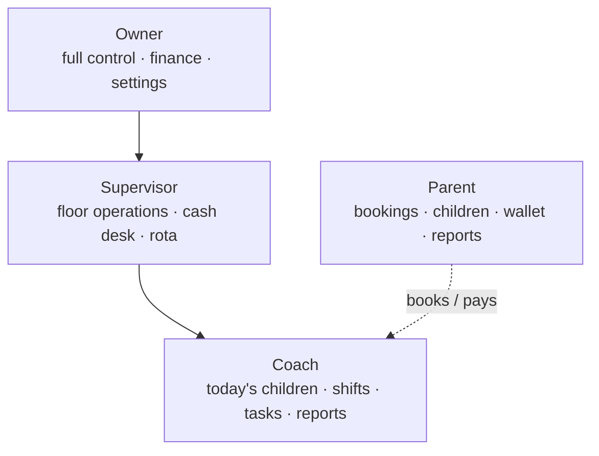
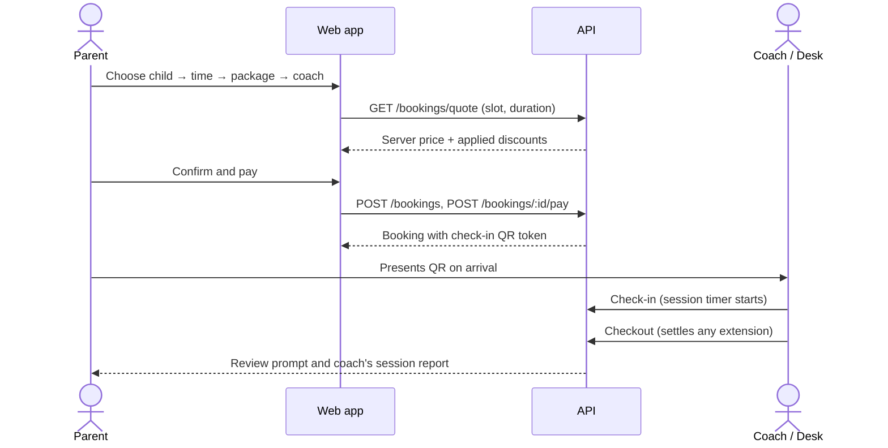

# 1. Product Overview

> **Summary.** Rainbow Playhouse is an hourly childcare and play centre. Its operations combine pre-booked sessions, a large volume of walk-in visits, a staff rota, a staffed cash desk and owner-level reporting. The platform models these as one connected system, so a booking, a walk-in, a coach's shift and a payment all feed the same figures the owner relies on.

[← Back to README](../README.md)

---

## 1.1 Business Context

The centre sells **time**. A family buys a package (for example 30, 60, 90 or 120 minutes), a coach looks after the child for that window, and the session may be extended at the desk. Several properties of the business shaped the design:

| Characteristic | Design consequence |
|---|---|
| Most visits are **walk-ins**, not reservations | Walk-ins (`Guest`) are first-class and appear in every figure that bookings do: revenue, coach utilisation, busy-hour charts, top customers. |
| Staffing changes weekly | A **rota** is the single source of truth for who can be booked, who can take a task, and who holds the till. |
| Cash, card and prepaid wallet credit coexist | One **cash-basis money model** prevents the same toman being counted twice. |
| The owner is not an accountant | Figures state their basis and period on screen ("money received", "this Jalali month", "last 30 days"). |
| The centre operates on Iranian civil time | All date logic runs on **Asia/Tehran** and the **Jalali calendar**, independent of server or device clock. |

## 1.2 Roles and Portals

| Role | Portal tabs | Representative capabilities |
|---|---|---|
| **Parent** | Home · Bookings · Children · Reports · Profile | Register children, book a session with a coach, pay (wallet, card, cash at desk), present a QR code at check-in, read daily session reports, rate the coach after each visit. |
| **Coach** | Today · Shifts · Scan · Messages · Tasks | See children currently in care with a live session timer, check children in by QR, view the weekly rota and request swaps, complete assigned tasks, write session reports with photos. |
| **Supervisor** | Children present · Shifts · Tasks · Cash desk | Run the floor: walk-in check-in, extensions, checkout and settlement, rota management, task assignment, wallet top-ups. |
| **Owner** | Dashboard · Customers · Operations · Coaches · More | Live dashboard, analytics, day-by-day archive, accounting and payroll, coach management (including suspension), centre settings (prices, tiers, programmes, opening hours, discounts, capacity). |

Cash-desk access for a coach is not a permanent role. It is granted by a till shift on the rota and lapses when that shift ends (see [Key Features §4.4](04-key-features.md#44-cash-desk-and-the-till)).

## 1.3 Core User Journeys

### Parent books and attends a session

### Walk-in at the desk

A supervisor or rostered cashier runs a five-step desk flow: **child → time → package → coach → payment**. A new visitor becomes a `Guest`. A registered family becomes a real `Booking`, which earns loyalty hours and can be paid from wallet credit. Only coaches who are physically **on shift** at that moment are offered.

### Owner closes the month

The owner reviews the dashboard and analytics, records expenses, approves the month's payroll run, and reads the profit-and-loss statement for the Jalali month. Approving payroll writes salary expenses atomically. A draft run counts for nothing.

## 1.4 Localisation

- Fully right-to-left Persian interface using the Vazirmatn typeface.
- Jalali dates throughout (`fa-IR-u-ca-persian` with explicit `Asia/Tehran`).
- Persian digits for display, with strict rules about which values may be shown in Persian digits. Credentials are always shown in ASCII; see [Case Study 6.1](06-engineering-case-studies.md#61-persian-digits-made-a-rostered-coach-unbookable).
- Installable as a Progressive Web App with an RTL manifest, app icons and theme colour.

---

[Next: System Architecture →](02-architecture.md)
