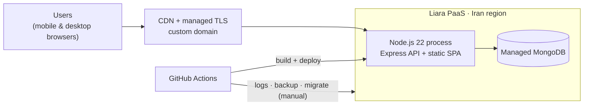
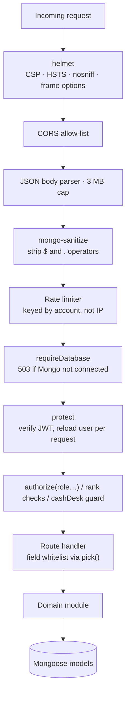

# 2. System Architecture

> **Summary.** The platform is a single-page React application served by the same Node.js process that exposes the REST API. Business rules live on the server in small, single-purpose domain modules (pricing, schedule, cash desk, roles, suspension, nightly jobs). Every route that needs a rule imports it from that one module instead of reimplementing it. The client is a thin, role-aware presentation layer over that API.

[← Back to README](../README.md)

---

## 2.1 Runtime Topology



One process serves both the compiled SPA and `/api/*`. That removes a class of CORS and cookie issues and keeps hosting to a single container. The client is built on the CI runner and shipped with the upload, so the PaaS has no build step that can time out.

## 2.2 Request Lifecycle



Design points:

- **The user is re-read on every request** (`protect`). A promotion, suspension or revoked access takes effect on the next API call without waiting for token expiry.
- **Writes are whitelisted.** Each resource declares the fields a client may set (for example `CLASS_FIELDS`, `EXPENSE_FIELDS`). Server-owned fields such as price, `dueAt`, `kind` and `by` are never accepted from the client.
- **Rate limits are keyed by account.** The centre's staff share one internet connection, so per-IP limits would throttle the whole building as one user.

## 2.3 Server Module Map

| Module | Responsibility |
|---|---|
| `server.js` | Process bootstrap, middleware chain, route mounting, health endpoint, static SPA serving |
| `auth.js` / `authRoutes.js` | JWT issuance and verification, login / register / password reset, role-rank rules for privileged actions |
| `bookings.js` | Booking lifecycle, quotes, payment and **`settleBooking()`**, the only code path that takes money for a booking, plus extensions |
| `coaches.js` | Coach records, availability for a slot, ratings and performance, suspension, avatar, account creation |
| `children.js`, `messages.js` | Child profiles; parent ↔ staff messaging |
| `featureRoutes.js` | Shifts, swaps, guests (walk-ins), tasks, register, payments, classes, events, invoices, waitlist, landing/settings, and the owner's `manager/*` API (dashboard, analytics, history, accounting) |
| `pricing.js` | Settings-backed price list, loyalty tiers, discount quote engine, 30-second cache with explicit invalidation |
| `schedule.js` | Opening windows, slot generation, roster coverage, Tehran clock, Jalali month arithmetic; **shared by server and client** |
| `cashdesk.js` | The single authority on who may operate the till right now (rota-derived) |
| `roles.js` / `suspension.js` | Who may be assigned a child (managers may not; suspended coaches may not) |
| `nightly.js` | In-process scheduler: register roll-over, automatic close, attendance sweep |
| `cascade.js` | Consistent clean-up when parent records are deleted |
| `migrate.js` | Idempotent, rehearsed data migrations |

The pattern is consistent: **one question, one module**. When "can this person take money now?" is asked in four routes, all four import `hasCashDesk()`, so the answers can't drift apart.

## 2.4 Frontend Structure

```
app/
├── App.jsx          role → tab set, navigation state, boot sequence, app-level sheets
├── ui.jsx           design primitives: Sheet (portalled), Avatar, Segmented, layout shell
├── shared.jsx       cross-role components: PresentList, UpcomingList, Field, SessionTimer
├── charts.jsx       dependency-free bar/line charts with value labels and peak highlighting
├── helpers.js       Jalali/Tehran formatting, digit normalisation, role-derived routing
├── useResource.js   data-loading hook with reload semantics
└── screens/         public · parent · coach · supervisor · manager · profile · account
```

- **Navigation** is an in-memory `view + params` stack, so a role-specific tab bar can be swapped atomically on login.
- **Shared components never hard-code a destination screen.** A component mounted by several personas navigates through `nav.back()` or a role-derived id (`messagesScreenFor(role)`). See [Case Study 6.5](06-engineering-case-studies.md#65-persona-leak-in-shared-navigation).
- **Overlays are portalled** to the screen root so they share a stacking context with the tab bar. See [Case Study 6.6](06-engineering-case-studies.md#66-every-bottom-sheets-submit-button-was-hidden-on-phones).
- **Responsive shell:** one breakpoint at 720 px, a content column capped at 960 px and a centred tab bar. The same build serves phones and the front-desk monitor.
- **Settings-driven UI:** prices, tiers and programmes are loaded once at boot and applied in place, so about 20 call sites read owner-configured values without changes.

## 2.5 Shared Code Between Client and Server

`schedule.js` is imported by both tiers. Slot generation, past-slot detection, Tehran day keys and Jalali month labels are therefore computed identically in the browser that offers a slot and in the server that validates it. If the screen offers a slot, the server will accept it, and the reverse holds too.

---

[← Product Overview](01-product-overview.md) · [Next: Domain Model →](03-domain-model.md)
