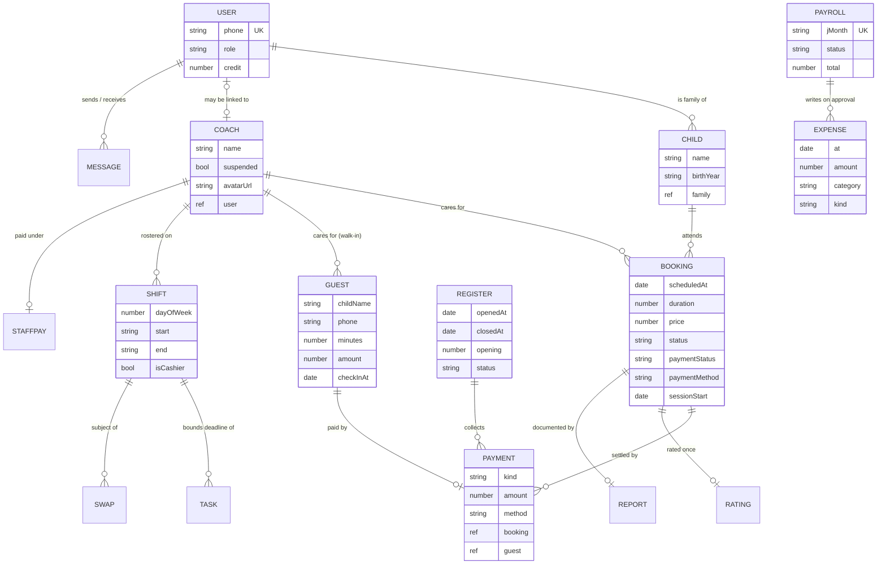

# 3. Domain Model

> **Summary.** The system persists 22 MongoDB collections. The core is a small number of transactional entities: `User`, `Child`, `Coach`, `Booking`, `Guest`, `Payment` and `Register`. Around them sit operational entities (`Shift`, `Task`, `Swap`), content (`ClassItem`, `EventItem`), feedback (`Rating`, `Report`) and owner finance (`Expense`, `StaffPay`, `Payroll`). A single `Settings` document holds every business parameter the owner can change.

[← Back to README](../README.md)

---

## 3.1 Entity-Relationship Diagram

*`Settings`, `AppState`, `ClassItem`, `EventItem`, `Invoice`, `Lead` and `Swap` details are omitted for readability.*

## 3.2 Key Entities and the Invariants They Protect

| Entity | Purpose | Invariants enforced by the server |
|---|---|---|
| **User** | Authentication identity; roles `parent`, `coach`, `supervisor`, `owner` | Phone is unique and the login key. `role` is never accepted at self-registration. Password reset codes can be issued only for a lower-ranked account. |
| **Child** | A child registered to a family | Family is derived from the authenticated parent, or from the child when staff act at the desk, never from the operator. |
| **Coach** | A care-giver record, optionally linked to a login | A suspended coach, or a coach who is also a manager, cannot be assigned a child. Suspension is refused while a child is in their care. |
| **Booking** | A reserved or desk-created session for a registered child | Price is computed server-side. A slot must fall within opening hours and must not be in the past (for self-service). The coach must be rostered for the whole session. |
| **Guest** | A walk-in visit | Price comes from server pricing; `amount` is not a client-writable field. A guest paid at check-in is never billed again at checkout. |
| **Payment** | An immutable ledger line (`sale`, `spend`, `topup`) | Attached to the **current** register for its Tehran day. Refused while the till is closed, except for checkouts that owe nothing. |
| **Register** | The till for one trading day | One open register at a time. It rolls over at its own day's end, carrying the float. |
| **Shift** | Weekly rota template entry | Times are normalised to ASCII `HH:MM` and validated (`end > start`). `isCashier` grants till access for exactly that window. |
| **Task** | Staff to-do bound to a shift | Deadline (`dueAt`) is resolved from the rota by the server. A coach may change only `status`. |
| **Rating** | One per completed session | Sparse unique index on `booking`. Allowed only for the caller's own completed session with that coach. |
| **Expense / StaffPay / Payroll** | Owner accounting | Salary expenses exist only through an approved payroll run. A second approval returns `409`. Salary rows cannot be edited from the general expenses list. |
| **Settings** | Every owner-editable parameter | Writes go through an explicit key whitelist. Pricing readers use a 30-second cache with explicit invalidation. |

## 3.3 Design Decisions in the Data Layer

- **Customer identity is the normalised phone number.** A registered family who also walks in is one customer with combined spend. Persian and ASCII digits and spacing are normalised before comparison.
- **Denormalisation where history matters.** `Booking.paymentMethod` and `tierAtBooking` record facts as they were when they happened, so later changes to settings don't rewrite history.
- **The ledger is immutable.** Missing display fields on older payment rows (child or parent name) are filled in **at read time** from linked records. Rows are never rewritten.
- **Indexes match the query shapes.** Analytics queries are bounded by time and backed by compound indexes such as `Booking {status, createdAt}` and `Payment {kind, createdAt}`. See [Quality §7.3](07-quality-and-testing.md#73-performance-engineering).
- **Removed fields are dropped through the raw collection.** Mongoose strict mode silently strips an `$unset` on a field the schema no longer declares, so migrations go through `Model.collection`.

---

[← System Architecture](02-architecture.md) · [Next: Key Features →](04-key-features.md)
