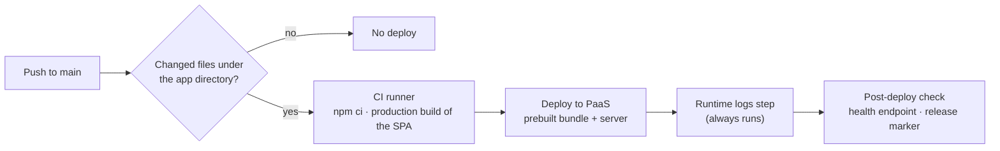

# 8. Deployment and Operations

> **Summary.** The platform runs on a managed PaaS in the Iran region behind a CDN with managed TLS and a custom domain. Delivery is automated through GitHub Actions: the client is built on the CI runner, deployment is path-filtered to the application's directory, and separate manually-triggered workflows provide logs, backups and migrations without shell access to production.

[← Back to README](../README.md)

---

## 8.1 Delivery Pipeline

| Workflow | Trigger | Purpose |
|---|---|---|
| **Deploy** | Push to `main` (path-filtered), manual | Build the client on the runner and deploy. Always prints the runtime log tail so a crash loop is visible in the CI run. |
| **Environment** | Manual | Apply environment variables from the CI secret store, then redeploy so they take effect |
| **Logs** | Manual | Read-only application status and log tail, for diagnosing without deploying |
| **Backup** | Manual | Database backup before risky operations |
| **Migrate** | Manual, typed confirmation | Back up, then run the idempotent migration script against production |

**Why the client is built on CI.** The PaaS builder repeatedly hit its 20-minute ceiling building the client. The same build finishes in seconds on the CI runner, so it now ships pre-built and the platform has no build step that can time out.

## 8.2 Environments and Configuration

| Variable | Role |
|---|---|
| `NODE_ENV` | `production` enables strict behaviour, including refusing to start without a signing secret |
| `JWT_SECRET` | Token signing secret. Required in production. |
| `MONGO_URI` | Database connection |
| `CLIENT_ORIGIN` | CORS allow-list |

Configuration values are held in the CI secret store and the hosting environment, never in the repository. Business configuration (prices, hours, discounts) is **data, not deployment**: the owner edits it in the app.

## 8.3 Observability

- `GET /api/health` reports process status and database connectivity.
- Request logging (`morgan`, combined format). The platform prefixes each log line with its release number, so logs can be tied to a specific deploy.
- Startup warnings for unsafe configuration, such as a missing CORS origin or the development secret.

## 8.4 Operational Lessons

- **Environment changes need a redeploy.** Setting variables and restarting did not reach the running container on this platform. Only a fresh deploy injected them, so the environment workflow always redeploys.
- **Never install-time build.** A `postinstall` build ran before the source was copied into the image and aborted every deploy. Builds run only as an explicit step.
- **Logs can be stale.** Buffered history can show crashes that are already fixed. Always read timestamps and the release marker before drawing conclusions.
- **Geo-filtered edges.** Requests from outside the country can receive a platform error page while local users are served normally. Use the platform's own status and logs as the source of truth for liveness.

## 8.5 Data Protection

- Backups are taken before every migration or bulk operation and kept off-platform.
- Seed scripts that create demonstration accounts are never run against production.
- A production reset before launch was preceded by a full export, and the platform's settings re-initialised themselves from schema defaults.

---

[← Quality & Testing](07-quality-and-testing.md) · [Next: Roadmap →](09-roadmap.md)
